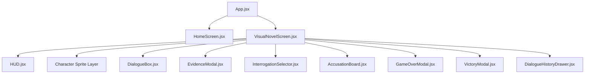

# 🔍 ForensicScript: The Interactive Forensic Visual Novel

[](https://reactjs.org/)
[](https://vitejs.dev/)
[](https://www.djangoproject.com/)
[](https://www.django-rest-framework.org/)
[](https://tailwindcss.com/)
[](https://www.framer.com/motion/)
[](https://forensicscript.vercel.app/)

> **Live Web Application:** [https://forensicscript.vercel.app/](https://forensicscript.vercel.app/)

**ForensicScript** is a cyber-noir forensic investigative visual novel web application. Players step into the shoes of a lead forensic investigator solving complex locked-room homicides by inspecting physical crime scenes, analyzing spectroscopic and telemetry evidence, interrogating suspects to expose contradictions, and delivering airtight grand indictments to state prosecutors.

Built as a full-stack project integrating a **React 18 / Vite frontend** styled with **Tailwind CSS and Framer Motion** and a **Django REST Framework / SQLite backend**, with an automatic **dual-mode client-side fallback engine** guaranteeing 100% uptime on static and serverless cloud deployments.

---

## 📖 Table of Contents
1. [Overview & Investigative Cases](#-investigative-cases)
2. [Key Gameplay Features & Mechanics](#-key-gameplay-features--mechanics)
3. [Architecture & Technical Implementation](#-architecture--technical-implementation)
4. [React State Management & Props Flow](#-react-state-management--props-flow)
5. [Backend & API Architecture](#-backend--api-architecture)
6. [Resilient Dual-Mode Deployment (Vercel & Local)](#-resilient-dual-mode-deployment-vercel--local)
7. [Local Development & Setup Guide](#-local-development--setup-guide)
8. [Asset Directory & Character Sprite Manifest](#-asset-directory--character-sprite-manifest)

---

## 📂 Investigative Cases

### Case 1: The Vanishing at Sector 7
* **Victim:** Dr. Aris Thorne (Age 42) — Principal Quantum Spectrometry Architect at Aether Biometrix.
* **Crime Scene:** Class-1 ISO Cleanroom (Sub-level 4, Sector 7).
* **The Locked Room:** Dr. Thorne is found dead with temporal head trauma inside a sealed cleanroom locked from the inside. Security logs confirm magnetic seals were intact with zero door cycles after midnight.
* **Suspects:**
  * **Dr. Elena Cruz:** Senior Spectrometry Lead (stole sensor patent USB).
  * **Kevin Lin:** Lead Firmware Engineer (bribed $5,000 to disable CCTV cameras for 90 seconds).
  * **Marcus Vance:** CEO & Founder (faced SEC ruin over falsified sensor yield whistleblower disclosures).
* **Forensic Clues:** Fluorinert coolant residue (E3), Bluetooth log timestamp (E4), conveyor hatch motor log (E2), and Thorne's encrypted flash drive (E5).

### Case 2: Case 08-NX: The Phantom Heir
* **Victim:** Julian Sterling (Age 64) — Billionaire Founder of Sterling Neural Dynamics.
* **Crime Scene:** The Obsidian Study & Biometric Vault, Sterling Ridge Manor.
* **The Locked Room:** Found slumped over his black marble desk inside a soundproof, Faraday-shielded vault sealed with an outer biometric thumb scanner. Security logs state the vault was sealed at 10:42 PM and Julian spoke over the intercom at 01:30 AM, but coroner liver temperature placed death at 02:00 AM.
* **Suspects:**
  * **Vivienne Sterling:** Eldest Daughter & CCO (entered manor grounds at 10:38 PM to steal bearer bonds).
  * **Rowan Brooks:** Head of Security (accepted $250k Cayman bribe to blind north-wing cameras and silence HVAC alerts).
  * **Dr. Cedric Laurent:** Personal Neurologist & Secret Illegitimate Son (disinherited at 09:00 PM for black-market patent trafficking).
* **Forensic Clues:** Vitreous potassium assay proving 10:40 PM death (E1), HVAC 6°C supercooling thermal inversion log (E2), transdermal DMSO & batrachotoxin scanner residue (E3), cloned EEG telemetry playback loop (E4), disinheritance codicil (E5), and synthesized intercom voice aliasing artifact (E6).

---

## 🎮 Key Gameplay Features & Mechanics

### 1. Cyber-Noir Visual Novel Narrative Engine
* **Cinematic Typewriter Effect:** Dynamic text rendering with character-by-character pacing and subtle typewriter audio clicks. Clicking the textbox allows instant text reveals.
* **Full-Height Character Cutouts:** Transparent RGBA 2K character sprites with reactive emotional states (neutral, defensive, tense, shocked, defeated).
* **Branching Multi-Choice Dialogues:** Interactive choices offering crime scene exploration, laboratory telemetry audits, suspect interrogations, and high-stakes penalties.

### 2. Action Point (AP) Focus Economy
* **50 AP Focus Pool:** Detectives start with 50 Action Points.
* **Deduction Rewards:** Sound forensic deductions and clue discoveries award **+10 AP**.
* **Reckless Deductions:** Unfounded accusations or aggressive bluffs trigger an AP penalty (**-15 AP** with penalty audio buzzers).
* **50% Grand Indictment Penalty:** Baseless or incorrect formal indictments reject the warrant and deduct **-20 AP**.
* **Internal Affairs Lockout (Game Over):** If AP hits 0, an administrative suspension modal locks further investigation. Players can wait for passive recharge (**+1 AP per minute**, up to 50 AP), practice fast recovery drills, or reinvestigate.

### 3. Forensic Evidence Dossier (Clues E1–E6)
* **Categorized Inventories:** Pathology, Environmental Telemetry, Chemical Trace Analysis, Digital Forensics, Documentary Evidence, and Audio Engineering.
* **Interactive Inspection Modal:** Clickable clue slots with detailed scientific inferences and courtroom contradiction cards.

### 4. Suspect Interrogation Chamber
* **Targeted Evidence Presentation:** Select a suspect in holding and present specific forensic clues.
* **Contradiction Breakdown:** Presenting the correct contradictory clue shatters their alibi, triggering their emotional breakdown sprite, unique dialogue, and official recorded testimony.
* **Objection Rejections:** Presenting irrelevant clues triggers suspect resistance and penalty cues.

### 5. 50% Evidence Gate & Grand Indictment Board
* **State Prosecutor Warrant Threshold:** Requires at least **3 out of 6 confirmed clues (50%)** before an arrest warrant will be granted.
* **Confrontation Action Bar:** When arriving at the confrontation room, the game presents a dedicated action bar:
  * **Accuse Killer Now [A]**
  * **Question Suspects [I]**
  * **Review Dossier [E]**
* **Indictment Form:** Players must identify the correct culprit **and** select the exact murder method. Correct submissions trigger the culprit's full confession, final grade, and celebratory fanfare.

### 6. Detective Career & Ranking System
* Persistent career records stored in `localStorage` tracking cases solved, highest Detective Rank (Junior Detective → Detective Inspector → Chief Superintendent → Master Forensic Detective), gender preference, and promotion alerts.

### 7. Synthesizer Audio Engine (Zero External Audio Bloat)
* Procedural audio synthesized in real time via the browser's native **Web Audio API**:
  * Typewriter keystroke clicks.
  * Clue acquisition chimes.
  * Contradiction strike fanfare.
  * Penalty buzzer sounds.
  * Grand indictment victory themes.

---

## 🏗️ Architecture & Technical Implementation

```
ForensicScript/
├── backend/                             # Django REST Framework Backend
│   ├── forensic_backend/               # Core Django Settings & WSGI Config
│   │   ├── settings.py                 # Multi-environment settings (local & Vercel /tmp DB)
│   │   ├── urls.py                     # API routing (/api/ and root rewrites)
│   │   └── wsgi.py                     # WSGI serverless application entrypoint
│   ├── investigation/                  # Core Game Domain App
│   │   ├── models.py                   # Case, Clue, DialogueNode, GameSession models
│   │   ├── serializers.py              # DRF ModelSerializers & Request Serializers
│   │   ├── views.py                    # REST views (Start, Action, Interrogate, Accuse)
│   │   ├── tests.py                    # Complete test suite (12 test cases)
│   │   └── management/commands/        # Seeding commands for Case 1 & Case 2
│   └── db.sqlite3                      # Pre-seeded SQLite database
├── frontend/                            # React 18 + Vite Frontend Application
│   ├── public/assets/                  # Public fallback static assets
│   ├── src/
│   │   ├── assets/                     # High-res character sprites & backgrounds
│   │   ├── components/                 # Modular React Components
│   │   │   ├── game/                   # Visual Novel & Investigation UI
│   │   │   │   ├── VisualNovelScreen.jsx  # Main VN layout, sprite layer, toasts
│   │   │   │   ├── DialogueBox.jsx        # Typewriter text, choice list, confrontation bar
│   │   │   │   ├── HUD.jsx                # Top bar: AP meter, quick buttons, clock
│   │   │   │   ├── EvidenceModal.jsx      # Dossier & forensic clue inspector
│   │   │   │   ├── InterrogationSelector.jsx # Suspect interview chamber
│   │   │   │   ├── AccusationBoard.jsx    # Final indictment & warrant execution form
│   │   │   │   ├── GameOverModal.jsx      # AP exhaustion lockout modal
│   │   │   │   ├── VictoryModal.jsx       # Case solved confession & summary modal
│   │   │   │   └── DialogueHistoryDrawer.jsx # Dialogue backlog drawer
│   │   │   └── home/                   # Title screen, Case selection, Profile modal
│   │   ├── hooks/
│   │   │   └── useDetectiveEngine.js   # Central game engine hook & state manager
│   │   ├── services/
│   │   │   ├── api.js                  # Resilient API client with automatic fallback
│   │   │   ├── localEngine.js          # Standalone client-side simulation engine
│   │   │   ├── localNarrativeData.json # Exported narrative dataset (51 nodes, 2 cases)
│   │   │   └── audio.js                # Web Audio API sound synthesis engine
│   │   └── utils/
│   │       ├── assetHelper.js          # Vite dynamic asset loader
│   │       └── profileStorage.js       # Persistent career statistics manager
├── vercel.json                         # Vercel deployment & routing configuration
└── README.md                           # Documentation & architecture guide
```

---

## 🔄 React State Management & Props Flow

The application follows clean **Unidirectional Data Flow** and modern React architectural patterns. The state is centrally orchestrated by the custom hook [`useDetectiveEngine.js`](file:///d:/SEM_5/FSAD/PROJECT_CAT/ForensicScript/frontend/src/hooks/useDetectiveEngine.js) and distributed to modular UI components via explicit props and action callbacks.

### Component Hierarchy & Props Mapping



### Detailed Component Specifications

| Component | Key State Owned (`useState` / `useRef`) | Key Props Received | Action Callbacks / Handlers |
| :--- | :--- | :--- | :--- |
| **`App.jsx`** | Engine instance (`useDetectiveEngine`) | None (Root) | Routes between `home` and `case` screens |
| **`HomeScreen.jsx`** | `isCaseModalOpen`, `isProfileOpen` | `engine`, `profile`, `onStartCase` | Triggers character select and case launches |
| **`VisualNovelScreen.jsx`** | Modal visibility flags (`isDossierOpen`, `isInterrogationOpen`, `isAccusationOpen`, `isHistoryOpen`) | `engine` | Coordinates overlays, keyboard shortcuts (`E`, `I`, `A`, `Esc`), and toasts |
| **`HUD.jsx`** | Tooltip hover states | `energy`, `unlockedCount`, `totalEvidence`, `currentCase`, `location`, `onOpenDossier`, `onOpenInterrogation` | Quick navigation to dossier, interrogation, and home |
| **`DialogueBox.jsx`** | `displayedText`, `isTyping`, `textIndexRef`, `timerRef` | `currentNode`, `choices`, `unlockedClues`, `caseData`, `onSelectChoice`, `onOpenAccusation`, `onOpenInterrogation`, `onRestartInvestigation` | Typewriter animation, choice branch clicks, and confrontation action bar |
| **`EvidenceModal.jsx`** | `selectedClue` | `isOpen`, `onClose`, `allClues`, `unlockedClueIds`, `minRequired` | Inspects clue scientific details and contradictions |
| **`InterrogationSelector.jsx`**| `selectedSuspectId`, `selectedClueId`, `isConfronting`, `feedbackResult` | `isOpen`, `onClose`, `unlockedClueIds`, `allClues`, `caseData`, `onPresentEvidence` | Submits clue-to-suspect contradiction check to engine |
| **`AccusationBoard.jsx`** | `selectedSuspect`, `selectedMethod`, `isSubmitting`, `feedbackError` | `isOpen`, `onClose`, `unlockedClueIds`, `caseData`, `onSubmitAccusation`, `onRestartInvestigation` | Validates 50% gate, submits indictment to prosecutor |
| **`GameOverModal.jsx`** | Drill timer | `isOpen`, `energy`, `onRestart`, `onResumeInvestigation`, `onFastRecover`, `onGoHome` | Handles AP exhaustion recovery drills |
| **`VictoryModal.jsx`** | None | `isOpen`, `victoryData`, `onReturnHome`, `onPlayAgain` | Displays culprit confession, grade, and case summary |

### React Hooks Utilized
* **`useState`**: Drives reactive interface states (active node, energy levels, open modals, typewriter text, active selections).
* **`useEffect`**: Manages typewriter interval timers, passive AP regeneration timers (+1 AP/min), session hydration from `localStorage`, and keyboard hotkey listeners (`E`, `I`, `A`, `Esc`).
* **`useCallback`**: Memoizes high-frequency callbacks (`handleAdvance`, `takeAction`, `showNotification`) to prevent unnecessary component re-renders.
* **`useRef`**: Tracks active typewriter indices (`textIndexRef`) and interval timers (`timerRef`) to support instantaneous text skips without stale state closures.

---

## ⚡ Backend & API Architecture

The backend is built with **Django 4.2** and **Django REST Framework (DRF)**.

### REST API Endpoints

| Endpoint | Method | Description | Request Payload | Response Data |
| :--- | :---: | :--- | :--- | :--- |
| `/api/cases/<id>/` | `GET` | Retrieve case metadata and clue list | None | Case details, total evidence, min required clues |
| `/api/sessions/start/` | `POST` | Initialize a new investigation session | `{"case_id": "...", "detective_gender": "m", "energy": 50}` | Created session, initial dialogue node |
| `/api/sessions/<id>/` | `GET` | Resume an active session | None | Restored session, current node, case info |
| `/api/sessions/action/` | `POST` | Execute a dialogue choice and advance narrative | `{"session_id": "...", "next_node_id": "...", "energy_delta": 10, "clue_unlock": "E1"}` | Updated session, new dialogue node, AP delta, unlocked clues |
| `/api/sessions/interrogate/` | `POST` | Present evidence against a suspect in holding | `{"session_id": "...", "suspect": "cedric", "clue_id": "E4"}` | Contradiction result (`success: true/false`), emotional breakdown sprite, dialogue |
| `/api/sessions/accuse/` | `POST` | Submit Grand Indictment to the prosecutor | `{"session_id": "...", "culprit": "cedric", "method": "dmso"}` | Verdict (`GUILTY`), culprit confession, grade, case summary |
| `/api/sessions/reinvestigate/`| `POST` | Restart investigation while preserving current AP | `{"session_id": "...", "energy": 35}` | Reset session at Scene 1 with preserved AP |
| `/api/sessions/sync-energy/` | `POST` | Synchronize client-side passive AP recharge | `{"session_id": "...", "energy": 45}` | Synced AP level |

### Database Models
* **`Case`**: Case ID, title, synopsis, crime scene location, `min_evidence_required` (3 clues), `total_evidence` (6 clues).
* **`Clue`**: Clue ID (`E1`–`E6`), foreign key to `Case`, scientific summary, inference deduction, and contradiction testimony.
* **`DialogueNode`**: Node ID, foreign key to `Case`, scene number, background asset, speaker name, sprite asset, text, audio cue, and `choices_json` array.
* **`GameSession`**: UUID primary key, active case, current AP energy, array of unlocked clue IDs, array of visited node IDs, detective gender, status (`active`, `game_over`, `solved`), and final grade.

---

## 🛡️ Resilient Dual-Mode Deployment (Vercel & Local)

Serverless hosting environments like **Vercel** present two common challenges for full-stack Django visual novel games:
1. **Read-Only Serverless Filesystem:** Lambda execution environments make the repository directory read-only, causing standard SQLite writes (`db.sqlite3`) to throw `OperationalError: attempt to write a readonly database`.
2. **Cold Starts & Network Latencies:** Serverless functions can experience cold starts, causing delayed responses.

### How ForensicScript Solves This:
1. **Server-Side `/tmp` Database Shadowing** in [`settings.py`](file:///d:/SEM_5/FSAD/PROJECT_CAT/ForensicScript/backend/forensic_backend/settings.py):
   * When deployed on Vercel (`IS_VERCEL = True`), Django automatically copies the pre-seeded `db.sqlite3` into the writable `/tmp/db.sqlite3` partition on Lambda initialization.
2. **Path Rewrite Normalization** in [`urls.py`](file:///d:/SEM_5/FSAD/PROJECT_CAT/ForensicScript/backend/forensic_backend/urls.py) & [`vercel.json`](file:///d:/SEM_5/FSAD/PROJECT_CAT/ForensicScript/vercel.json):
   * Routes both `/api/` and root rewrites to `investigation.urls`, eliminating prefix-stripping routing mismatches.
3. **Transparent Client-Side Simulation Engine** in [`localEngine.js`](file:///d:/SEM_5/FSAD/PROJECT_CAT/ForensicScript/frontend/src/services/localEngine.js) & [`api.js`](file:///d:/SEM_5/FSAD/PROJECT_CAT/ForensicScript/frontend/src/services/api.js):
   * All 51 dialogue nodes, 12 clues, interrogation contradiction matrixes, and indictment verification algorithms are embedded in the frontend bundle.
   * If the network fetch returns HTTP 500, fails, or is offline, [`api.js`](file:///d:/SEM_5/FSAD/PROJECT_CAT/ForensicScript/frontend/src/services/api.js) instantly and invisibly delegates the request to the client-side engine.
   * **Result:** The game runs smoothly with zero interruption, zero error screens, and zero latency on [https://forensicscript.vercel.app/](https://forensicscript.vercel.app/).

---

## 💻 Local Development & Setup Guide

### Prerequisites
* **Node.js** (v18 or higher) & **npm**
* **Python** (v3.9 or higher)

### 1. Clone the Repository
```bash
git clone https://github.com/Dhanumithra/ForensicScript.git
cd ForensicScript
```

### 2. Backend Setup (Django)
```bash
# Install Python dependencies
pip install -r requirements.txt

# Run migrations
python backend/manage.py migrate

# Seed Case 1 (The Vanishing at Sector 7)
python backend/manage.py seed_sector7

# Seed Case 2 (The Phantom Heir)
python backend/manage.py seed_phantom_heir

# (Optional) Run test suite to verify all 12 test cases
python backend/manage.py test investigation

# Start Django development server
python backend/manage.py runserver 8000
```
*Backend API will be running at:* `http://127.0.0.1:8000/api/`

### 3. Frontend Setup (React / Vite)
```bash
# Navigate to frontend directory
cd frontend

# Install dependencies
npm install

# Run Vite development server
npm run dev
```
*Frontend application will be accessible at:* `http://localhost:5173/`

### 4. One-Click Launch (Windows)
A preconfigured batch script [`run_dev.bat`](file:///d:/SEM_5/FSAD/PROJECT_CAT/ForensicScript/run_dev.bat) is provided in the root directory to launch both the Django backend and Vite frontend concurrently.

---

## 🎨 Asset Directory & Character Sprite Manifest

All character assets are high-resolution transparent RGBA PNG sprites:

| Character | Role | Sprite Identifiers |
| :--- | :--- | :--- |
| **Julian Sterling** | Billionaire Victim | `julian_neutral.png`, `julian_deceased.png` (Study body) |
| **Dr. Cedric Laurent** | Neurologist / Illegitimate Son | `cedric_neutral.png`, `cedric_cold.png`, `cedric_defeated.png` |
| **Vivienne Sterling** | Eldest Daughter & CCO | `vivienne_neutral.png`, `vivienne_defensive.png`, `vivienne_shocked.png` |
| **Rowan Brooks** | Head of Manor Security | `rowan_neutral.png`, `rowan_tense.png` |
| **Marcus Vance** | CEO & Case 1 Culprit | `vance_neutral.png`, `vance_angry.png`, `vance_defeated.png` |
| **Dr. Elena Cruz** | Spectrometry Lead | `elena_neutral.png`, `elena_defensive.png`, `elena_shocked.png` |
| **Kevin Lin** | Firmware Engineer | `kevin_neutral.png`, `kevin_nervous.png`, `kevin_panicked.png` |
| **Dr. Aris Thorne** | Case 1 Victim | `thorne_neutral.png`, `thorne_deceased.png` |
| **Officer Miller** | Senior Patrol Officer | `officer_miller_neutral.png`, `officer_miller_serious.png` |
| **Detective Player** | Player Avatar | `detective_m_neutral.png`, `detective_f_neutral.png` |

---

## 📜 License
This project is licensed under the MIT License. Developed for advanced interactive narrative design and web systems engineering.
